<p align="center">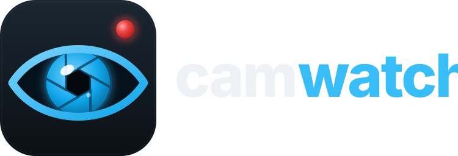</p>

# camwatch

Self-hosted camera service for one RTSP camera: motion and object detection (YOLOv8), push alerts with snapshots (ntfy), event recordings with pre/post-roll, offline face identification against your own photo library, number-plate reading, a "who came and when" presence log, a web UI and Home Assistant integration. Runs as a Docker Compose stack on a small Debian VM or Proxmox LXC; everything stays on your LAN.

> **Maintainers / LLMs: read [HANDOVER.md](HANDOVER.md)**: architecture, data formats, every setting, operations and known issues.

## Features

- **Recording**: copies the camera stream without re-encoding into a rolling buffer; each event becomes one MP4 with pre-roll, plus snapshot and metadata.
- **Detection**: cheap pixel motion gates YOLOv8 (person, car, truck, motorcycle, bicycle, dog, cat, …); parked vehicles are ignored automatically; loitering alerts.
- **Zones** drawn in the web UI: ignore, trigger (alerts say "person at door"), house/street (arrived/left), parking (car arrived/left).
- **Alerts** via ntfy (server, topic and login set in Settings) with snapshot and **Open / Star / Snooze 1h** buttons; arm/disarm with schedule; snooze a camera; camera offline alerts; daily summary.
- **Several cameras** (up to 4), added in Settings with **Find** (network scan + ONVIF reads the stream addresses); a walk past several cameras is one visit with one push and *Play all*.
- **Unusual activity**: each camera learns when people, cars and animals normally appear; a visit at an unusual time or place gets an urgent push.
- **Faces**: offline matching of recorded clips against `photos/<Person>/`; tag faces in the UI to improve matching; automatic re-check when the library changes.
- **Number plates** of arriving/moving vehicles, known plates with names.
- **Presence log** in MariaDB: visits, who, direction, cars coming and going.
- **Dashboard** (`/dashboard`): today at a glance and a tile for every page.
- **Weekly report** (`/report`) with per-day/hour charts and a heatmap of where people walk; weekly push.
- **Packages**: draw a package zone on the doorstep to get "delivered" / "picked up" alerts.
- **Timelapse**: the whole day in a minute plus a highlights reel of every event, built nightly.
- **Share a blurred copy** of a clip (faces and plates pixelated, sound removed).
- **Search** recordings by description ("white van", "person with a dog") with a local CLIP model.
- **Recurring strangers**: unknown faces seen in several clips, grouped so you can name them once.
- **Quiet household alerts**: known faces get a quiet push, strangers the loud one.
- **Optional no-password access on the LAN** (Settings).
- **Wall view** (`/view`): a phone/tablet page with live picture, filter chips and a swipeable full-screen player.
- **Phone home** (`/m`): a page made for phones - what needs attention (camera offline, unusual visits, packages, strangers, off-site failing, snoozes), swipeable live cameras with *Snooze 1h*, today's numbers and recent visits, arm/disarm, a bottom tab bar. The installed app opens here.
- **Phone app**: add camwatch to the home screen (manifest + icons; full app install on Android needs HTTPS).
- **Web UI**: clips with timeline and filters, player, stars (never auto-deleted), people & photo library, plates, zones editor, settings, presence log, live view, end-to-end test button, Home Assistant guide.
- **Home Assistant**: MQTT auto-discovery (sensors, armed switch, snapshot camera, event entity) and/or webhook.
- **Off-site storage** (Settings): copies to iCloud Drive, Google Drive, OneDrive, Dropbox, Backblaze B2, S3 or a NAS (SFTP/SMB) via rclone; encrypted by default; alarms uploaded within a minute, the rest nightly; retention and speed limit.
- **Optional extras**: read-only JSON feed for dashboard panels; copy starred clips to iCloud Drive via a Windows share.

## Screenshots

`python dev/screenshots.py` takes these screenshots from demo pictures. They show no real camera footage.

| | |
|---|---|
| 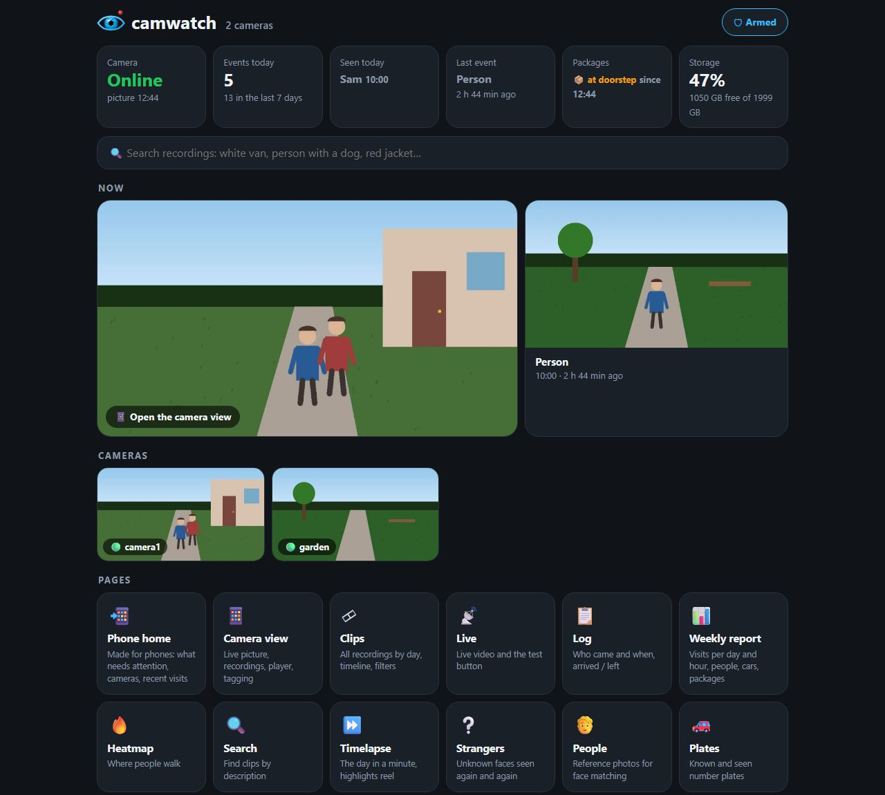<br>**Dashboard**: shows a summary of today, the live cameras and a tile for every page. | 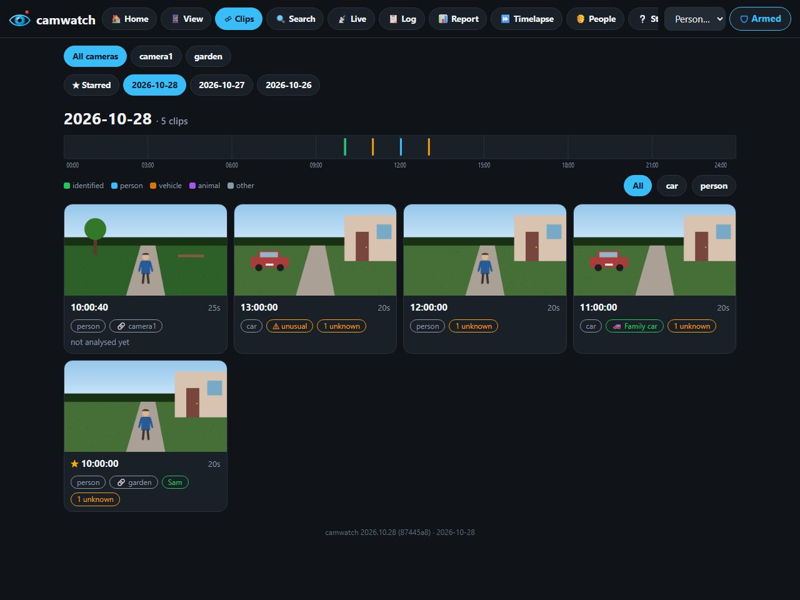<br>**Clips**: lists the clips of each day on a timeline. You can filter and tag the clips. |
| 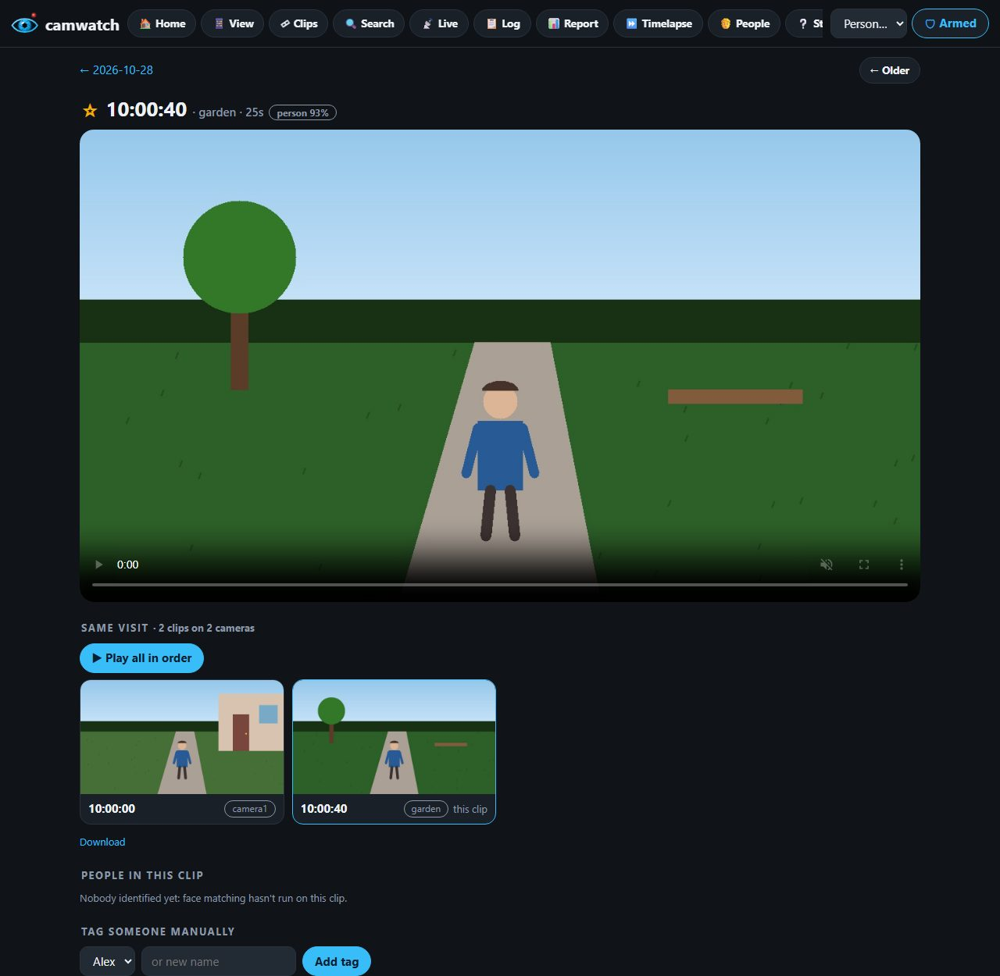<br>**Clip**: plays one clip. *Play all* plays every camera in the same visit. You can name the faces. | 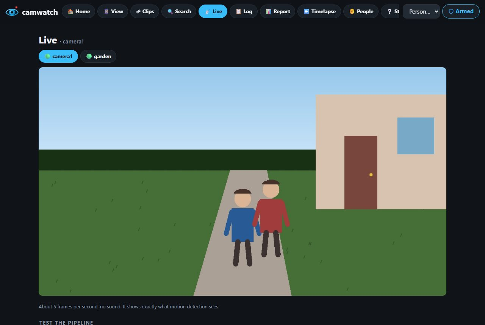<br>**Live**: shows every camera live. A button tests the whole chain from camera to phone alert. |
| 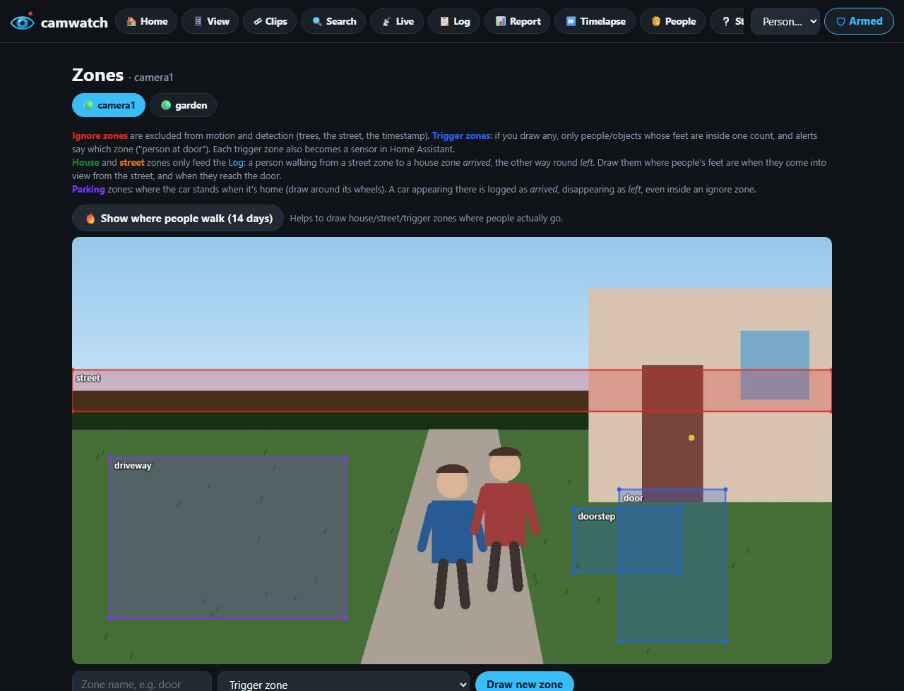<br>**Zones**: you draw the areas that start, ignore or mark activity for each camera. | 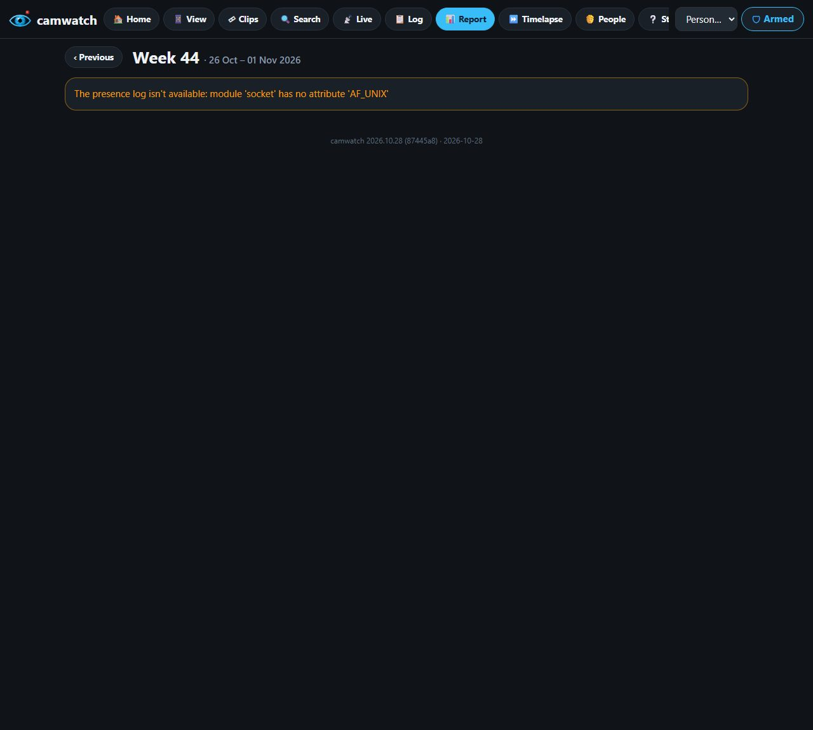<br>**Report**: counts visits per day and per hour. A map shows where people walk most often. |
| 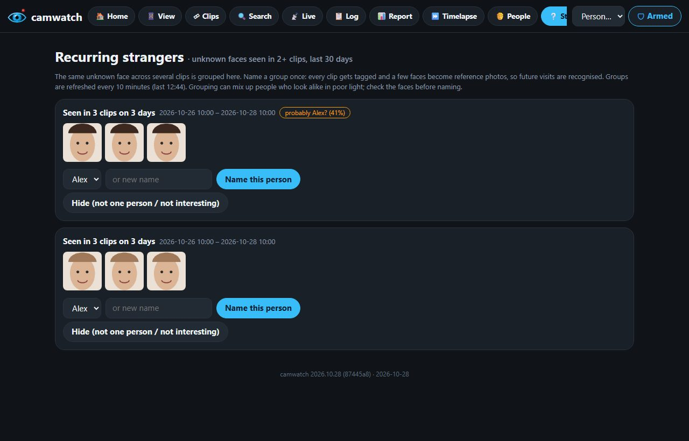<br>**Strangers**: groups unknown faces that come back. You name each person once. | 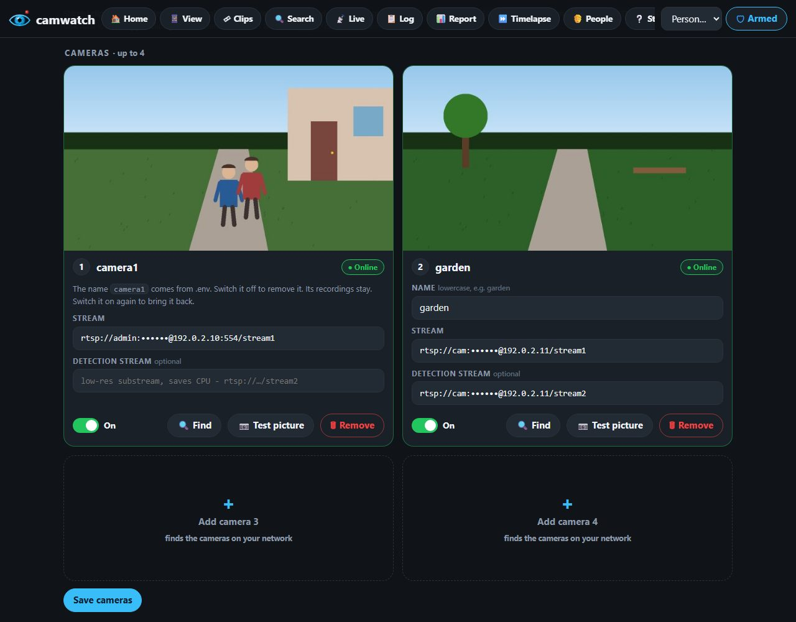<br>**Settings, cameras**: holds up to 4 cameras. *Find* searches your network for cameras. |
| 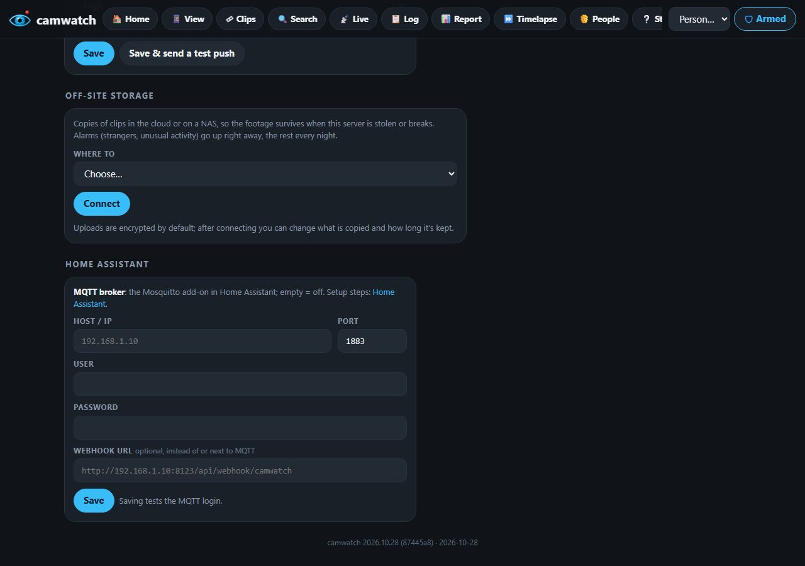<br>**Settings, off-site copies**: copies clips to iCloud, Google Drive or another place. Home Assistant settings follow below. | |

| Phone: home | Phone: cameras | Phone: settings |
|---|---|---|
| 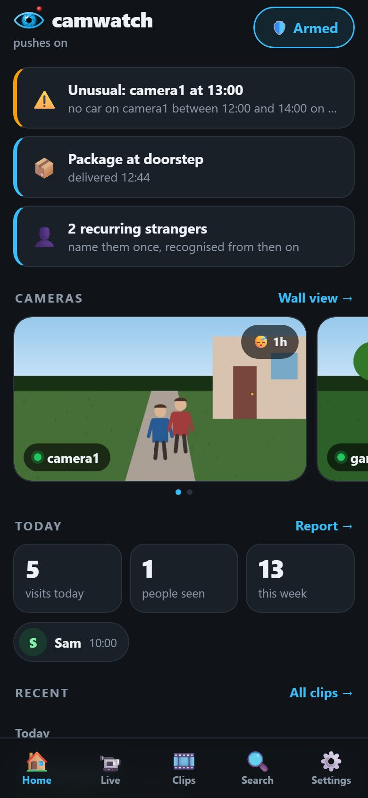 | 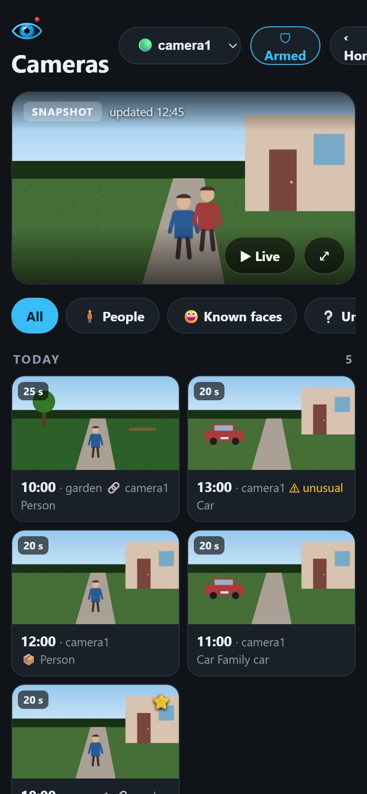 | 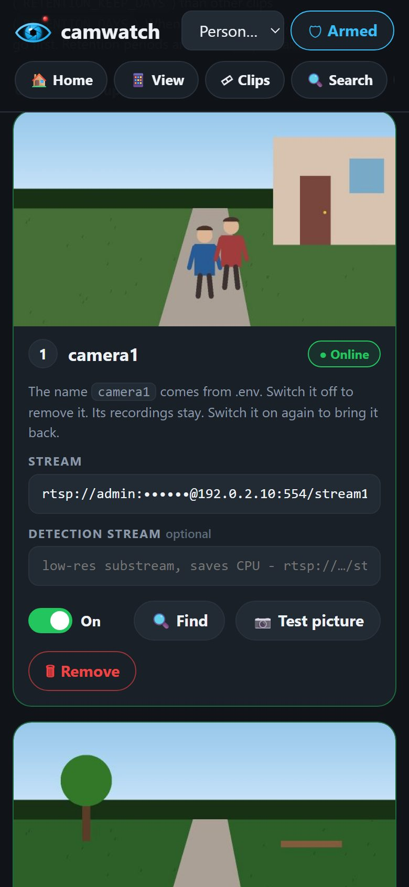 |

## Containers

| Container | What it does |
|---|---|
| `camwatch-recorder` | Always on: RTSP → buffer, motion/objects, events, alerts, plates, parking, HA, retention |
| `camwatch-facematch` | Offline face identification of finished clips |
| `camwatch-presence` | Presence log in MariaDB, daily summary |
| `camwatch-webui` | Web UI on port 8080 |
| `camwatch-offsite` | Off-site uploads (idle until set up in Settings) |
| `camwatch-recorder-2..4` | Camera slots 2-4; idle until a camera is added in Settings |

## Install

Prerequisites: Debian 12/13 VM or LXC (Proxmox LXC: `pct set <CTID> --features nesting=1,keyctl=1`), a data disk for recordings, MariaDB on the host for the presence log:

```bash
sudo apt install mariadb-server
sudo mariadb -e "CREATE DATABASE camwatch; CREATE USER 'camwatch'@'localhost' IDENTIFIED BY 'choose-a-password'; GRANT ALL ON camwatch.* TO 'camwatch'@'localhost';"
```

Then:

```bash
git clone https://github.com/johanhoel/amplitude.git && cd amplitude/CamWatch
cp .env.example .env        # set RTSP_URL, NTFY_TOPIC, TZ, paths, WEB_BASE_URL, WEB_PASSWORD, DB_PASSWORD
sudo ./deploy.sh            # installs Docker if needed, copies to /opt/camwatch, builds and starts
```

Open `http://<host>:8080`, subscribe to your `NTFY_TOPIC` in the ntfy app, then on the **Live** page press **Simulate motion** to test the whole chain (push → clip → clip page).

### More cameras

Up to 4 cameras: the first is in `.env`, the others are added on the web UI's **Settings → Cameras** (name, RTSP stream, optional detection substream, a *Test picture* button). They start within seconds, no restart needed. Each camera has its own recorder container and zones; clips, live view, heatmap, timelapse and the dashboard show all cameras with a picker.

## Use

- **People**: add 3–10 clear face photos per person; faces in clips can be assigned with "This is them".
- **Zones**: draw ignore areas (trees, street) and optional trigger/house/street/parking zones on the live picture.
- **Plates**: save known plates with a name; known cars get quiet pushes.
- **Settings**: arm/disarm or schedule, loitering time. Retention is in `.env` (starred clips are kept forever, clips with identified people longer).
- **Home Assistant**: follow the **Home Assistant** page in the web UI; the MQTT broker (IP, user, password) and webhook are entered under **Settings → Home Assistant**.

## Optional extras (host services)

```bash
# dashboard feed (needs python3-pil); edit FEED_ALLOW in the unit first
sudo cp extras/systemd/camwatch-feed.service /etc/systemd/system/ && sudo systemctl enable --now camwatch-feed
# nightly database dump into DATA_PATH/db-backup (include DATA_PATH and PHOTOS_PATH in your host backup)
sudo cp extras/systemd/camwatch-db-backup.* /etc/systemd/system/ && sudo systemctl enable --now camwatch-db-backup.timer
# starred clips -> iCloud Drive (needs smbclient; set ICLOUD_SHARE / ICLOUD_CRED in .env)
sudo cp extras/systemd/icloud-sync.* /etc/systemd/system/ && sudo systemctl enable --now icloud-sync.timer
```

## Operations

```bash
cd /opt/camwatch
sudo docker compose ps
sudo docker compose logs -f recorder
sudo docker compose up -d --build && sudo docker builder prune -af   # after code changes
```

## Privacy

Face recognition and plate reading process other people's personal data. Point the camera at your own property, keep retention short, protect the web UI with `WEB_PASSWORD`, keep it off the internet (use a VPN), and never commit `.env`.

## License notes

Object detection uses Ultralytics YOLOv8 (AGPL-3.0); face models from the OpenCV model zoo (Apache-2.0); plate models from fast-alpr (MIT).
