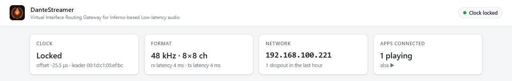
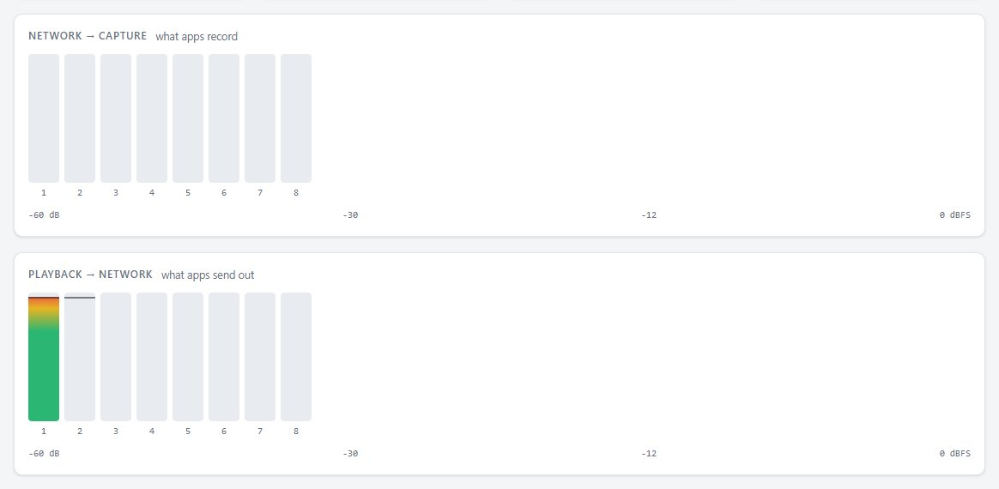
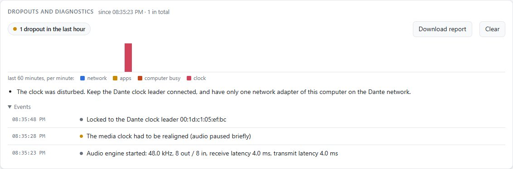
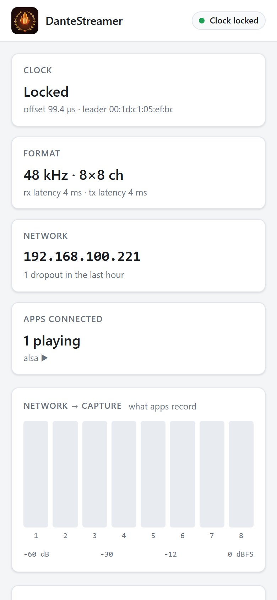

# DanteStreamer

**Stream audio to Dante networks from any device — AirPlay, Google Cast, or native Dante.**

Self-hosted Dante player built on [Inferno](https://github.com/teodly/inferno) (open-source Dante protocol implementation) with multi-source input support.

```
AirPlay (iOS/macOS)  │  Google Cast (Android)  │  Dante Network
        │                      │                        │
        └──────────┬───────────┴────────────┬───────────┘
                   │                        │
              ┌────▼────────────────────────▼────┐
              │    DanteStreamer Container       │
              │  (AirPlay + Chromecast Receiver) │
              │  (DanteStreamer Engine)         │
              └────┬─────────────────────────────┘
                   │
              ┌────▼──────────┐
              │  Dante Network │
              │  (Speakers,    │
              │   Monitors,    │
              │   Mixers, etc) │
              └───────────────┘
```

---

## Features

✅ **Multi-Source Input**
- AirPlay from iOS, macOS, iTunes
- Google Cast from Android, Chromecast devices
- Native Dante network audio

✅ **Single Output**
- Dante network (128 channels @ 44.1–96 kHz)
- Route to any Dante-capable device (speakers, monitors, mixers)

✅ **Easy Deployment**
- Docker container (Linux, Mac, Windows)
- Runs on Raspberry Pi, VM, or server
- No Dante hardware dongle required* (*if joining existing network)

✅ **Control & Monitoring**
- HTTP REST API
- Web dashboard
- CLI management
- Real-time level meters & clock sync status

✅ **Production-Ready**
- Low-latency audio (configurable 0.25–4 ms)
- Automatic network failover
- Dropout detection & logging
- PTP clock synchronization

---

## Screenshots

The control panel (Virgil Control) runs on the DanteStreamer host at
`http://127.0.0.1:8480/`.

| | |
|---|---|
| <br>**Status**: Dante clock lock and leader, sample rate and channels, network address, apps playing | <br>**Meters**: live levels per Dante channel, both directions (AirPlay plays on transmit 1 and 2) |
| <br>**Dropouts and diagnostics**: dropouts per minute by cause, what to do about them, and an event log | <br>**Routing**: how DanteStreamer appears in Dante Controller |
| <br>**Settings**: device and channel names, interface, sample rate, latency, clock, remote access, start/stop | |

| Phone |
|---|
|  |

---

## Quick Start

### Prerequisites
- Docker + Docker Compose
- Ethernet connection (for Dante network)
- One device on the same network (to send audio: iPhone, Android, Mac, Chromecast)

### Run (3 commands)
```bash
git clone https://github.com/johanhoel/amplitude.git
cd amplitude/dantestreamer
docker compose up -d --build
```

**That's it.** DanteStreamer is now running:
- 🎵 Send AirPlay from your iPhone → plays on Dante network
- 📱 Send Google Cast from Android → plays on Dante network
- 📡 Connect native Dante devices → routes seamlessly

### Access Control Panel
```
http://localhost:8080
```

---

## How It Works

### Architecture
```
┌─────────────────────────────────────┐
│  Input Layer                        │
│  • Shairport-sync (AirPlay RX)      │
│  • Snapcast (Google Cast RX)        │
│  • ALSA input (native audio)        │
└────────────┬────────────────────────┘
             │
        ┌────▼──────────────┐
        │  ALSA Mixer       │  Combines all sources
        │  (multiple streams)
        └────┬──────────────┘
             │
        ┌────▼──────────────────┐
        │  DanteStreamer Engine │  Encodes to Dante
        │  (Inferno protocol)   │
        └────┬──────────────────┘
             │
        ┌────▼─────────────┐
        │  Dante Network    │  Routable to any device
        │  (UDP multicast)  │
        └──────────────────┘
```

### Flow
1. **AirPlay device** (iPhone) sends audio → Shairport-sync receives it
2. **Chromecast device** (Android) sends audio → Snapcast receives it
3. Both streams → ALSA mixer (combines into single output)
4. **DanteStreamer** reads ALSA mixer, encodes as Dante packets
5. **Dante network** receives audio, routes to speakers/monitors

---

## Configuration

### Names (Dante, AirPlay, channels)
Give each DanteStreamer its own name so it's easy to find in Dante
Controller and on your phone. Names live in `.env` next to
`docker-compose.yml`:

```bash
cp .env.example .env
nano .env                 # DEVICE_NAME, AIRPLAY_NAME, TX_CHANNEL_NAMES
docker compose up -d      # applies the new names
```

- `DEVICE_NAME`: name in Dante Controller (letters, digits, `-`, `_`,
  spaces; max 31). It is reapplied on every start, so rename the device
  here rather than in Dante Controller.
- `AIRPLAY_NAME`: name your phone shows. Empty = same as `DEVICE_NAME`.
- `TX_CHANNEL_NAMES` / `RX_CHANNEL_NAMES`: comma-separated channel names,
  e.g. `AirPlay L,AirPlay R`. AirPlay plays on TX 1 and TX 2. Leave
  empty to keep names set in Dante Controller.

The live Virgil config is `data/virgil.conf` (created from
`config/dantestreamer.conf` on first start).

### Edit Settings
```bash
vim config/dantestreamer.conf
```

**Key settings:**
```toml
[device]
name = "DanteStreamer"      # Name in Dante Controller
enabled = true

[network]
interface = ""              # Auto-detect (or specify eth0, en0, etc)
tx_latency_us = 4000        # Transmit ahead (4 ms default)
latency_us = 4000           # Receive buffer depth

[audio]
sample_rate = 48000         # 44.1, 48, or 96 kHz
channels = 8                # How many channels output to Dante

[inputs]
airplay_enabled = true      # Listen for AirPlay
airplay_port = 5000

chromecast_enabled = true   # Listen for Google Cast
chromecast_port = 5353

[logging]
level = "debug"             # info, warn, error
file = "/var/log/dantestreamer.log"
```

### Restart After Changes
```bash
docker-compose restart dantestreamer
```

---

## Usage Examples

### iOS → Dante
1. Open **Control Center** (swipe down from top-right)
2. Long-press **Music** or **AirPlay**
3. Select **DanteStreamer**
4. Play music → appears on Dante network

### Android → Dante
1. Open **Google Home** or **Chromecast app**
2. Select **DanteStreamer** as cast target
3. Play music → appears on Dante network

### Route Dante Audio
Use **Dante Controller** (on any device on network):
1. Open Dante Controller
2. Find **DanteStreamer** in device list
3. Drag channel to your speaker/monitor
4. Audio routes automatically

---

## API Endpoints

### Status
```bash
curl http://localhost:8080/status
```

Response:
```json
{
  "device_name": "DanteStreamer",
  "enabled": true,
  "clock_locked": true,
  "sample_rate": 48000,
  "channels": 8,
  "inputs": {
    "airplay": {"connected": true, "level_db": -18.5},
    "chromecast": {"connected": false},
    "dante": {"connected": true, "level_db": -22.0}
  },
  "output": {
    "dante": {"level_db": -20.2}
  }
}
```

### Control
```bash
# Stop DanteStreamer
curl -X POST http://localhost:8080/control/stop

# Start DanteStreamer
curl -X POST http://localhost:8080/control/start

# Get diagnostics
curl http://localhost:8080/diagnostics
```

---

## Deployment

### Docker
Single container, all services included:
```bash
docker-compose up -d
docker-compose logs -f
```

### Systemd (Linux)
```bash
sudo cp systemd/dantestreamer.service /etc/systemd/system/
sudo systemctl enable dantestreamer
sudo systemctl start dantestreamer
```

### Kubernetes
```bash
kubectl apply -f k8s/dantestreamer-deployment.yaml
```

### Raspberry Pi
Pre-built installer:
```bash
sudo apt install dantestreamer-rpi
sudo systemctl start dantestreamer
```

---

## Architecture Details

**Components:**
- **DanteStreamer Engine** – Dante protocol implementation (based on Inferno library)
- **Shairport-sync** – AirPlay receiver
- **Snapcast** – Google Cast receiver
- **ALSA** – Audio mixing & I/O
- **HTTP API** – Control panel & REST endpoints

**Networking:**
- UDP 319/320 – PTP (Dante clock sync)
- UDP 5353 – mDNS (device discovery)
- TCP/UDP 4440, 4455, 8700, 8800 – Dante control
- Audio flows on UDP multicast (224.x.x.x / 239.x.x.x)

**Latency:**
- AirPlay → Dante: ~100–200 ms (typical)
- Chromecast → Dante: ~200–500 ms (typical)
- Dante → Speaker: Configurable (0.25–4 ms)
- Total: ~200–700 ms end-to-end

---

## Troubleshooting

### "No input devices detected"
```bash
docker exec dantestreamer aplay -l
docker exec dantestreamer arecord -l
```

### "AirPlay not appearing in Control Center"
- Verify `airplay_enabled = true` in config
- Check firewall allows UDP 5000
- Restart container: `docker-compose restart dantestreamer`

### "Dante clock not locked"
```bash
curl http://localhost:8080/status | grep clock_locked
```
- Wait 10–30 seconds (PTP convergence)
- Verify network connectivity
- Check if another Dante device is on network (should provide master clock)

### "No audio on Dante network"
```bash
curl http://localhost:8080/status | grep input
```
- Verify audio is playing on source device (AirPlay/Chromecast)
- Check input levels (should show negative dB, not 0)
- Verify Dante routes in Dante Controller

### High latency or dropouts
- Reduce `tx_latency_us` in config (minimum 1000)
- Check network: wired > Wi-Fi, gigabit > 100 Mbps
- Monitor CPU load: `docker stats dantestreamer`

---

## Building from Source

See [BUILD_AND_TEST.md](BUILD_AND_TEST.md) for development setup.

---

## API Integration

For custom apps & integrations, see [VIRGIL_API_REFERENCE.md](VIRGIL_API_REFERENCE.md).

---

## Docker Details

See [DOCKER_SETUP.md](DOCKER_SETUP.md) for container configuration, networking, and production deployment.

---

## License

Built on [Inferno](https://github.com/teodly/inferno) (open-source Dante protocol implementation, GPLv3).  
DanteStreamer is also GPLv3. See [LICENSE](LICENSE) for details.

---

## Support & Contributing

- **Issues:** [GitHub Issues](https://github.com/johanhoel/dantestreamer/issues)
- **Discussions:** [GitHub Discussions](https://github.com/johanhoel/dantestreamer/discussions)
- **Contributing:** See [CONTRIBUTING.md](CONTRIBUTING.md)

---

## Roadmap

- [x] Dante receiver (Inferno protocol base)
- [x] AirPlay input (Shairport-sync)
- [x] Google Cast input (Snapcast)
- [x] ALSA mixer integration
- [x] Docker deployment
- [ ] Web dashboard (enhanced UI)
- [ ] Recording to file (MP3/WAV)
- [ ] Multi-output (simultaneous Dante + analog)
- [ ] Mobile app (iOS companion)
- [ ] Dante transmit (send to network)

---

**Built for ProAV, Broadcast, and Home Audio.** Deploy anywhere, stream from anywhere.
