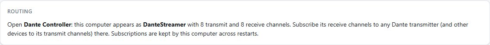
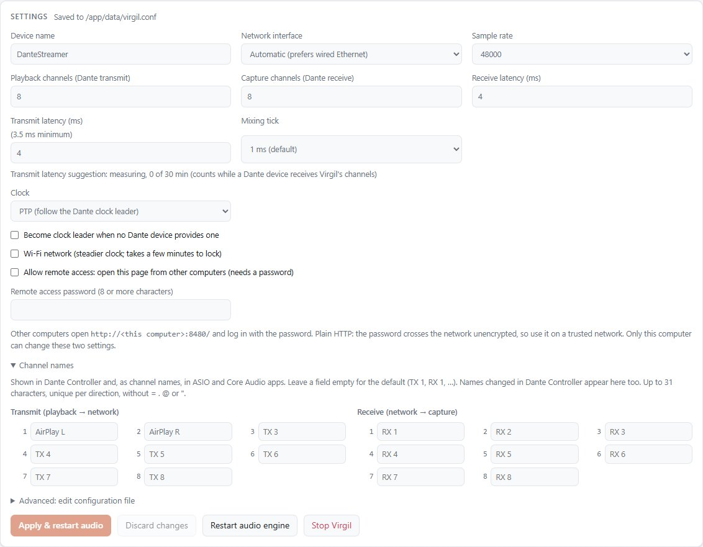

# DStreamer

DStreamer plays AirPlay audio from an iPhone, iPad or Mac into a Dante
network. It shows up in Dante Controller as a Dante device with 8 transmit
and 8 receive channels. AirPlay plays on transmit channels 1 and 2, which you
route to any Dante speaker, amp or mixer.

It runs in one Docker container on a Linux host. The Dante side is
[Virgil](https://github.com/Audbol/virgil-virtual-soundcard), a virtual
soundcard built on [Inferno](https://github.com/teodly/inferno), the
open-source Dante implementation. AirPlay comes in through
[Shairport Sync](https://github.com/mikebrady/shairport-sync).

```
iPhone / Mac ──AirPlay──> Shairport Sync ──> ALSA "virgil" device ──> Virgil ──> Dante network
                          (in the DStreamer container)              TX 1-2     (Dante Controller routes it)
```

## Screenshots

The control panel (Virgil Control) runs on the DStreamer host at
`http://127.0.0.1:8480/`.

| | |
|---|---|
| <br>**Status**: Dante clock lock and leader, sample rate and channels, network address, apps playing | <br>**Meters**: live levels per Dante channel, both directions (AirPlay plays on transmit 1 and 2) |
| <br>**Dropouts and diagnostics**: dropouts per minute by cause, what to do about them, and an event log | <br>**Routing**: how DStreamer appears in Dante Controller |
| <br>**Settings**: device and channel names, interface, sample rate, latency, clock, remote access, start/stop | |

| Phone |
|---|
|  |

## Features

- AirPlay receiver, named whatever you like, mixed into Dante transmit 1 and 2.
- Dante device with up to 128 channels each way at 44.1, 48, 88.2 or 96 kHz
  (8 by 8 at 48 kHz by default), following the network's Dante clock leader.
  It can lead the clock itself when no other Dante device does.
- Device, AirPlay and channel names set in one `.env` file.
- Control panel with clock status, level meters, dropout diagnostics and
  settings, plus a REST API on the same port.
- Renames made in Dante Controller and Stop/Start in the panel are saved
  across restarts.

Google Cast is not supported yet. The image includes Snapcast, but Snapcast
is not a Cast receiver, so it is switched off (`CHROMECAST_ENABLED=false`).

## Requirements

- A Linux host on the same wired network as your Dante devices: a VM with a
  bridged network card, a mini PC or a Raspberry Pi. Docker Desktop on Mac
  or Windows does not work, because Dante needs the host's network for PTP
  and multicast.
- Docker with the Compose plugin.
- A Dante clock leader on the network, usually any Dante hardware. Without
  one, tick "Become clock leader" in the panel (`master_capable = true`).

Tested on Debian 13 in a Proxmox VM with Docker 29.

## Install

```bash
git clone https://github.com/johanhoel/amplitude.git
cd amplitude/dstreamer
cp .env.example .env            # set the names, see below
docker compose up -d --build
```

The first build compiles Virgil from source and takes a few minutes. Then:

1. On an iPhone, open Control Center, long-press the music player, tap the
   AirPlay icon and pick DStreamer (or the name you set).
2. In Dante Controller, subscribe your speaker's receive channels to
   DStreamer's transmit 1 and 2 (`AirPlay L` and `AirPlay R`).

## Names

Give each DStreamer its own name so it's easy to find in Dante
Controller and on your phone. The names are in `.env` next to
`docker-compose.yml`:

```bash
nano .env                 # DEVICE_NAME, AIRPLAY_NAME, TX_CHANNEL_NAMES
docker compose up -d      # applies the new names (a few seconds of silence)
```

- `DEVICE_NAME`: name in Dante Controller (letters, digits, `-`, `_`,
  spaces; max 31). It is reapplied on every start, so rename the device
  here rather than in Dante Controller.
- `AIRPLAY_NAME`: name your phone shows. Empty means the same as
  `DEVICE_NAME`.
- `TX_CHANNEL_NAMES` / `RX_CHANNEL_NAMES`: comma-separated channel names,
  e.g. `AirPlay L,AirPlay R`. Leave them empty to keep names set in Dante
  Controller.

A name that breaks Dante's rules stops the container with a message in
`docker compose logs` instead of starting with a bad name.

## Other settings

Virgil's live config is `data/virgil.conf`, created from
`config/dstreamer.conf` on first start. Change settings in the panel's
Settings section, or edit the file and run
`docker compose restart dstreamer`.

| Setting | Default | What it does |
|---|---|---|
| `interface` | empty (first wired adapter) | Network adapter on the Dante network, by name or IPv4 address |
| `sample_rate` | `48000` | Must match the other Dante devices |
| `tx_channels` / `rx_channels` | `8` / `8` | Dante channels each way, up to 128 |
| `latency_us` / `tx_latency_us` | `4000` | Receive buffer and transmit lead in microseconds; transmit needs at least 3.5 ms |
| `master_capable` | `false` | Lead the Dante clock when no other device does. Only one device per network should. |
| `remote_access` | `false` | Open the panel to other computers; needs `remote_password` |

The full reference is `config/virgil.conf.example` in the Virgil repo.

## Control panel and API

The panel and API listen only on the host itself, at `127.0.0.1:8480`.
To open them to other computers, for example for the
[desktop apps](../dstreamer-desktop/), add a password of at least 8
characters to `.env` and run `docker compose up -d`:

```
REMOTE_PASSWORD=choose-a-password
```

This turns on `remote_access` in `data/virgil.conf` on every start. It is
plain HTTP, so use it only on your own network or through a VPN. Removing
the line leaves remote access as it is; turn it off in the panel's
Settings. The other way in is an SSH tunnel. The local port must be 8480,
because Virgil checks it:

```bash
ssh -L 8480:127.0.0.1:8480 <user>@<host>      # then open http://localhost:8480/
```

API endpoints, all under `http://127.0.0.1:8480`:

| Endpoint | What it returns or does |
|---|---|
| `GET /api/status` | Device, clock state, channel names, meters, dropouts, connected apps |
| `GET /api/config`, `POST /api/config` | Read or change the settings |
| `GET /api/diagnostics` | Dropout history and events (`/api/diagnostics/report` for a full report) |
| `GET /api/interfaces` | Network adapters Virgil can use |
| `POST /api/start`, `/api/stop`, `/api/restart` | Join or leave the Dante network, restart the audio engine |

```bash
curl -s http://127.0.0.1:8480/api/status | python3 -m json.tool
```

## macOS Usage

### Running DStreamer on macOS

**Docker Desktop on Mac does not work for Dante** because Dante requires direct access to the host's network for PTP (clock sync) and UDP multicast. Docker Desktop on Mac runs a lightweight Linux VM that cannot expose the host's Ethernet interface properly.

### Options for macOS Users

#### Option 1: Linux VM on Mac (Recommended)

Run DStreamer in a Linux virtual machine with **bridged networking**:

**Using Parallels Desktop:**
1. Create Ubuntu 24.04 LTS VM
2. Network adapter → Bridged (connect to host's Ethernet)
3. Inside VM: `sudo apt install docker.io docker-compose-plugin`
4. Clone and run DStreamer

**Using UTM (free):**
1. Download Ubuntu Server 24.04 LTS ISO
2. Create VM: 4GB RAM, 20GB disk minimum
3. Network → Bridged mode to macOS Ethernet interface
4. Install Docker: `sudo apt install docker.io docker-compose-plugin`

**Using VMware Fusion:**
```bash
# Inside Linux VM on Mac
git clone https://github.com/johanhoel/amplitude.git
cd amplitude/dstreamer
cp .env.example .env
docker compose up -d --build
```

#### Option 2: Separate Linux Device

Deploy on a dedicated device on your Dante network:
- Raspberry Pi 4/5 (~$70)
- Intel NUC or mini PC (~$300–500)
- Used laptop/workstation with Ubuntu

Same setup as above, runs 24/7 if needed.

### Using DStreamer from macOS

Once running on any Linux host, control it **entirely from your Mac**:

#### Send AirPlay from Mac

1. **iTunes or Music app** → Now Playing
2. Click **AirPlay icon** (⌘⌥A)
3. Select **DStreamer**
4. Play music → routes to Dante network

#### Access the Control Panel

If `REMOTE_PASSWORD` is set in `.env`:
```bash
# Direct access (HTTP only, trusted network only)
http://<linux-host-ip>:8480/
```

Or use an SSH tunnel (secure, works anywhere):
```bash
ssh -L 8480:127.0.0.1:8480 user@<linux-host-ip>
# Then open http://localhost:8480/ on your Mac
```

#### Query the API from Terminal

```bash
# Check status
curl -s http://<linux-host-ip>:8480/api/status | python3 -m json.tool

# Read current config
curl -s http://<linux-host-ip>:8480/api/config | python3 -m json.tool

# Or with SSH tunnel
ssh -L 8480:127.0.0.1:8480 user@<host> "sleep 999" &
curl -s http://localhost:8480/api/status | python3 -m json.tool
```

#### Dante Controller on macOS

Download **Dante Controller** (free, Dante Virtual Soundcard Edition):
1. Install from [Dante Distributor](https://www.audinate.com/product/dante-controller)
2. Network: should auto-discover DStreamer device
3. Drag to subscribe to DStreamer TX 1–2 on your speakers/mixers

### macOS Network Setup

**Requirements:**
- Ethernet cable from Mac to Dante network (wired strongly recommended)
- Linux host also on same wired Dante network
- Same network subnet

**Verify connectivity:**
```bash
# From Mac terminal, ping the Linux host
ping <linux-host-ip>

# Should respond in < 5ms if on same network
```

### Typical macOS Workflow

1. **Deploy:** Set up Linux VM or Raspberry Pi with DStreamer
2. **Dante network:** Ethernet from both Mac and Linux host to switch
3. **Control:** SSH tunnel or direct access to `http://<host>:8480/`
4. **Send audio:** AirPlay from iTunes, Music, or Spotify on Mac
5. **Route:** Dante Controller on Mac to subscribe speakers/mixers to TX 1–2
6. **Monitor:** Panel shows clock lock, levels, dropouts

## Network ports

The container uses the host's network (`network_mode: host`), so these ports
are open on the host itself:

| Port | Use |
|---|---|
| UDP 319, 320 | PTP, the Dante clock |
| UDP 5353 | mDNS: Dante and AirPlay discovery |
| UDP 4440, 4455, 8700, 8800 | Dante control |
| TCP 5000 | AirPlay |
| TCP 8480 (localhost) | Control panel and API |

Audio travels as UDP multicast. If another Dante program on the host already
uses the control ports, Virgil moves to 24440-24443 (`ports = auto`).

## Troubleshooting

```bash
docker compose ps                     # should say "healthy"
docker compose logs -f dstreamer  # startup, clock and AirPlay messages
```

- **DStreamer missing from Dante Controller.** The host must be on the
  same network segment as the Dante devices, with a bridged (not NAT)
  network card if it's a VM. Check `interface` and the address on the
  panel's Status card.
- **Clock not locked.** Give PTP 10 to 30 seconds after start. If it never
  locks, no device leads the clock: enable "Become clock leader" on exactly
  one device.
- **No AirPlay device on the phone.** The phone and the host must be on the
  same network, and mDNS (UDP 5353) and TCP 5000 must get through.
  `docker exec dstreamer avahi-browse -rt _raop._tcp` lists what is
  advertised.
- **AirPlay connects but Dante is silent.** Check the transmit meters in the
  panel. If 1 and 2 move, the subscription in Dante Controller is missing.
- **Dropouts.** The panel's diagnostics section names the cause. A VM can
  lose clock timing under load; wired Ethernet and a quiet host help, and
  bare metal is more reliable than a VM.

## Files

| File | What |
|---|---|
| `docker-compose.yml` | The container, its capabilities, volumes and settings |
| `Dockerfile` | Builds Virgil from source, then the runtime image with Shairport Sync |
| `docker-entrypoint.sh` | Applies names, then starts D-Bus, Avahi, Virgil and Shairport Sync |
| `.env.example` | Names template; copy to `.env` |
| `config/` | Templates for Virgil, Shairport Sync, ALSA and Snapcast |
| `data/`, `logs/` | Created at runtime: live Virgil config and logs (not in git) |
| `tools/screenshots.py` | Captures the panel screenshots in `docs/screenshots/` |
| [`BUILD_AND_TEST.md`](BUILD_AND_TEST.md) | How the image is built, and how to check a change works |

## Roadmap

- [x] AirPlay to Dante
- [x] Docker deployment
- [x] Editable device, AirPlay and channel names
- [ ] Google Cast input
- [ ] Recording to file (MP3/WAV)
- [ ] Output to Dante and analog at the same time
- [ ] iOS companion app

## License

Virgil and Inferno are GPLv3, and DStreamer is GPLv3 too. A `LICENSE`
file has not been added to this folder yet.
