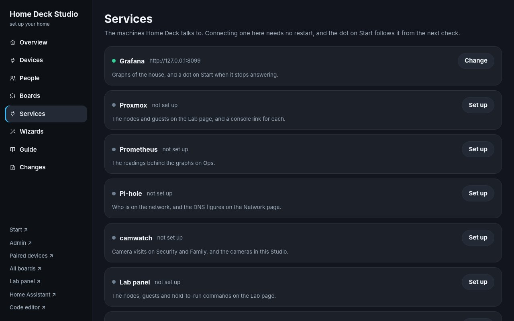

# Home Deck

The home's dashboard system, in `panels/`: wall panels and their backend,
phone pages, the Studio configuration UI, your own boards, a camera panel,
the Android app and the edge proxy config.

A fresh install knows nothing about any house. It installs the panels and a
setup wizard; the wizard asks the network what is there and writes the
settings. Everything the pages show about a house comes from those settings.

## Screenshots

| | |
|---|---|
| <br>**Start**: the wall home: who's home, front door, lights, weather, next bus, now playing | <br>**Control**: every switch in the house, speakers and media |
| <br>**Rooms**: all lights, room by room | <br>**Media**: Sonos, Spotify and the Apple TV remote |
| <br>**Ambient**: night-time clock with door and camera-alert status | <br>**Boards**: your own dashboards, built from modules |
| <br>**Lab panel**: every server and service at a glance | <br>**Local AI**: wake the PC, load and unload its language models, open OpenCode, Claude Code or video-use on the PC |
| <br>**Local AI chats**: saved chats; an answer keeps going on Home Deck when the page closes | <br>**Studio, services**: the machines Home Deck talks to. Each one says what it gives you and where to find its address, tests before it saves, and needs no restart. |

| Phone: Remote | Phone: Family info | Phone: Local AI | Phone: Local AI chat |
|---|---|---|---|
|  |  |  |  |

The setup wizard, which a fresh install opens first:

| | |
|---|---|
| <br>**Scan**: what was found on the network | <br>**Home Assistant**: address found by the scan, token, connect |
| <br>**Home**: door lock and weather, or automatic | <br>**Media**: which players to show; speakers found on the network |
| <br>**Network**: status dots for routers, servers and recorders | <br>**Review**: the exact settings lines that change |

## Features

- **Wall panels**: Start, Control, Rooms, Media and a night-time Ambient
  clock, on a tablet or a screen on the wall.
- **Phone pages**: the remote, family info and Local AI, laid out for a phone.
- **Boards**: your own dashboards, built from modules in the browser.
- **Lab panel**: every server and service in the house at a glance.
- **Local AI**: wake the PC, load and unload its language models, and keep a
  chat going on Home Deck after the page closes.
- **Studio**: the configuration UI for devices, people and cameras, with the
  camera list and face library coming from CamWatch over a link key.
- **Camera panel**: live pictures, visits and clips through a read-only feed,
  so Home Deck never touches the recordings.
- **Android app**: the panels as an app, built from `app/` and served from
  the Home Deck machine.
- **Setup wizard**: scans the network, connects Home Assistant and writes the
  settings for a fresh install.

## Install

Two ways, and they install the same code. `install.sh` puts Home Deck on the
machine under systemd; Docker keeps it in a container. Both end at the same
setup wizard.

### On the machine, with systemd

On a new Debian or Ubuntu machine, from a checkout of this folder:

```bash
sudo ./install.sh
```

It starts the panels and prints the **setup wizard** address
(`http://<machine>:8089`) and a one-time setup code. The wizard:

1. scans the network (Home Assistant, Pi-hole, Proxmox, cameras and recorders,
   Sonos, Google Cast, Apple TV, Dante speakers, routers). It only asks devices
   what they are; nothing is changed.
2. connects Home Assistant (paste a long-lived token). Rooms, lights, people,
   players, the lock and the weather then come from Home Assistant by themselves.
3. suggests the rest for you to confirm: which players and people to show, the
   door lock and weather, and status dots on Start for the routers, servers and
   recorders it found.
4. shows the exact lines of `homedeck.toml` that change, saves (old copy kept),
   restarts with automatic rollback, and switches itself off.

What the wizard does not set stays empty, and an empty setting keeps its part of
the panels away: the volume dial appears because there are speakers in
`homedeck.toml`, the bus card because there is a stop, the wake button because
there is a PC. A fresh install ships no addresses of its own - it shows the rooms
and lights, and the rest as you fill it in.

Run the wizard again any time with `sudo homedeck-onboard`, or
`sudo homedeck-onboard --show` to see the setup code that is already set (running
the plain command makes a new one). Running `install.sh` again updates the code
and keeps settings, token and layouts.

### In Docker

```bash
docker compose up -d --build
docker compose logs -f          # the setup wizard's address and one-time code
```

The server is pure standard library, so the image is a copy of `server/` on
`python:3.12-slim` - nothing to build and no venv.

It runs with **host networking**, which is not a convenience: presence sends
ARP probes and reads the neighbour table to tell who is home, and the wizard
scans the network for Home Assistant, speakers and cameras. Behind a bridge
both see Docker's own network instead of the house. The panels would still
show rooms, lights and media from Home Assistant; who-is-home and the scan
would find nothing.

Two folders stay outside the image, so a new image never touches the house:

| Folder | What |
|---|---|
| `data/` | `homedeck.toml` - the house. Never in the image, never in git. |
| `state/` | the Home Assistant token, layouts, boards, the setup code |

What differs from the systemd install:

- **A restart** is the container restarting. `homedeck-apply` checks the
  settings and then stops the container, and the restart policy brings it
  back. The code comes from the image and cannot drift, so the check is the
  whole safety net: settings that would not load never reach a restart.
- **An update** is a new image (`docker compose pull`, or `up -d --build`
  from a checkout). The update card in Settings says the updater is not
  installed, which is true here.
- **The panel editor** (`:8088`) is not in the container.

Run the wizard again later:

```bash
docker compose run --rm -e HOMEDECK_ONBOARD=1 homedeck
```


## Use

```bash
tools/pull-live.sh     # bring anything changed directly on the server into git (then commit it)
tools/staging.sh       # run this repo's Home Deck on :8099 with throw-away state
tools/check.sh         # compile + settings check (+ smoke test of every page when staging runs)
tools/deploy.sh        # the only way to production: refuses if live was edited by hand, rolls back on failure
```

`deploy.sh` tries the new version on the server before anything goes live: a
trial Home Deck on port 8099 with the real settings, read-only, and every page
must answer.

## How it is built

| Folder | What | Lives on |
|---|---|---|
| `server/` | Home Deck backend (`homedeck/`), settings (`homedeck.toml`), every page (`www/`) | the Home Deck machine, `/opt/panel-wrapper` |
| `services/camwatch-feed/` | read-only camera feed (visits, thumbnails, video) | CT 102 `.81` `/opt/camwatch-feed` |
| `infra/` | edge nginx site (`:8126`), `homedeck-apply`, `homedeck-onboard`, the systemd units | the edge machine, the Home Deck machine |
| `onboard/` | setup wizard for fresh installs: network scan, suggestions, writes `homedeck.toml` (`install.sh` installs it with the generic edition) | `/opt/homedeck-onboard` |
| `app/` | Android app + Docker builder (`build.sh`, `publish.sh`) | builds here, APK to `www/app/` on the Home Deck machine |
| `kit/` | installer, services and the `homedeck.sh` one-liner | published on winrepo `.41` |
| `editor/` | the panel editor | port 8088 |
| `docs/` | Studio handbook | |
| `tools/`, `tests/` | pull-live, deploy, staging, check; Playwright smoke test | |

There is one edition. There used to be two, and the second - a copy with the
owner's hardware stripped out by a generator - was what every fresh install
actually received. The stripping is becoming configuration, so the same pages
serve any house.

## Notes

The repository is public, so it holds no house: no addresses, no names, no entity
ids. A page that needs to know something about this house asks the settings for
it - the consoles on Start and Admin are `[links.extra]`, the Deck's Stream Deck
page is `[services] buttons_panel`, the music player is `[entities] spotify`. The
house's own values stay on the server, in two files that are never in git:

- `/opt/panel-wrapper/homedeck.toml` holds the settings. `deploy.sh` never
  uploads it. The copy in `server/` is the empty template that `check.sh`,
  `staging.sh` and the tests use.
- `/opt/panel-wrapper/private.map` lists `placeholder==>real value`, one pair per
  line, for anything that still has to differ. `deploy.sh` puts the real values
  into the copy it uploads, and `pull-live.sh` puts the placeholders back before
  anything reaches git. See `tools/private.py`.

`tests/install.py` holds that line: it fails if an address from anyone's network
appears in the settings template or in any page under `server/www`.

Never in git (see `.gitignore`): `secrets.json`, `private.map`, the app signing
key (`app/signing`, kept in `~/homedeck-app/signing`), build output.
